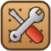

# Jig Rack



A rack of small, purpose-built Windows tools ("jigs") in one notification-area app.

In a workshop, a jig is a simple fixture you build for one job so you can do it quickly and the same way every
time. Jig Rack is that idea for the desktop: one small native program (plain C, Win32 and the GDI+ flat API, no
runtime, no installer) that sits in the tray and holds a few single-purpose tools. It's meant to be light: no
background polling it doesn't need, no services, no drivers.

## The jigs

### Mouse battery

Shows the battery level of a Logitech wireless mouse, without G HUB: one on a Logitech receiver (LIGHTSPEED,
Unifying, Bolt) or plugged in by its cable.

Choose it in **Settings → Mouse**: set **Mouse type** to Logitech and pick the mouse from the list of the ones
found, with their battery level. A mouse that's asleep doesn't answer, so move it and click **Refresh** if it
isn't listed. With **Show the mouse battery meter in place of the Jig Rack icon** ticked, the tray icon becomes a
small mouse above a horizontal battery with the percentage in it:

| Colour | Meaning |
|---|---|
| Blue | Charging |
| Red | Low: at or below the **Low battery** level (20% unless you change it) |
| Yellow | 50% or less |
| Green | Above 50% |
| Grey `?` | No reading yet (receiver unplugged, mouse asleep or off) |

Hover for the details (for example "Mouse battery 63% - charging"). With no mouse chosen, or the meter turned off,
the tray shows the Jig Rack icon instead.

**Low battery at or below** (on the same tab) sets what "low" means: the meter turns red there, and hot corner
countdowns can warn you (see below).

A monitor thread keeps the chosen mouse's receiver open, so the mouse's own battery events show up at once; a
backstop check (one 20-byte request and its reply) runs every 5 s. If the receiver is unplugged it retries every
15 s. With no mouse chosen it does nothing at all. The mouse is remembered by its receiver (USB product ID) and its
slot on it, so it's found again even while it's asleep.

### Hot corners

Rest the cursor in a screen corner and something happens: lock the PC, sleep, turn off the screens, show the
desktop, open Task View, or run a command. Out of the box, resting 5 s in the **top-right of the workspace** locks
the PC.

Set it up in **Settings → Hot Corners**: a list of rules, with **+** and **-** to add and remove them. Each rule
picks:

- **Corner**: top-left, top-right, bottom-left or bottom-right.
- **Where**: the whole workspace (all monitors together), any monitor, or one particular monitor.
  - "The workspace's top-right" is the top-right corner of the monitor that reaches furthest right (the highest one
    if two tie), so the corners between monitors don't count. The other three work the same way.
  - "Any monitor" is that corner of every monitor.
  - A particular monitor is remembered by its display device path, so it's the same screen after docking or
    rearranging; while it isn't connected the rule does nothing.
- **Action**, and for "Run a command" the command (a program with its arguments, a document or a URL).
- **Delay**: how long the cursor has to rest there, in seconds (decimals are fine).
- **Show the countdown**: a white, black-outlined countdown next to the corner, from 0.5 s in. It's a layered,
  click-through window that never takes focus.
- **Warn if mouse battery is low** (part of the countdown, so only with it on): a red line with the countdown says
  "Mouse battery 12% — charge it" when the chosen mouse is at or below the Mouse tab's low level and isn't
  charging (the last reading counts, even while the mouse sleeps). Handy on the corner you use to lock the PC
  before walking away.

Two rules can share a corner (say, show the desktop after 1 s and lock after 5 s); each fires at its own time.

- The cursor counts as "in the corner" within 3 px of it. The position is polled every 100 ms with
  `GetCursorPos` (which also works over elevated windows), and only while there's at least one rule. Corners are
  recalculated when the display layout changes, and every 5 s as a backstop.
- A click cancels (so a window's close button in that corner still works). After an action or a cancel, the cursor
  has to leave the corner before that rule can fire again, so coming back from the lock screen doesn't lock again.

### Eject media

Safely remove a USB drive, an external USB disk or a memory card without hunting for the "Safely Remove Hardware"
icon. Right-click the tray icon: each drive that can be removed is right there in the menu, for example
**Eject E: BACKUP — Samsung PSSD T7 (1.0 TB)**, so it's one click, with **Eject all** when there's more than one.
With nothing to eject the menu is just Settings and Exit. A notification says when it's safe to unplug, or why it couldn't be ejected (usually a file still open on it).

- A disk with several drive letters is one entry, since ejecting it removes them all. The Windows drive and
  internal disks are never listed, and nor is an empty card reader.
- Ejecting asks Windows to remove the device, just as "Safely Remove Hardware" does, so Windows makes sure nothing
  has a file open and flushes the drive first. A card in a built-in reader is dismounted and its media ejected,
  leaving the reader. It runs in the background and retries for a moment if a file was only just closed.
- The list is read each time the menu opens; there's nothing running in between.

### Downloads

Like the Downloads stack in a Mac's Dock: a Downloads button on the taskbar of every monitor (Windows' own
Downloads icon unless you pick another, with no label, so it takes about as much room as a pinned icon).

- **Click it** and a panel pops up above it with the newest items in the folder, each with its icon, size and how
  long ago it arrived ("5 min ago", "Yesterday", "Nov 3"). Click one to open it, drag it out to copy or move it
  anywhere (Explorer, the desktop, an email), or right-click it for **Show in folder**. Click the button again,
  press Esc or click anywhere else to close it.
- **Right-click it** for the stack's menu: **Sort by** Name, Kind, Date Added or Date Modified (the current one is
  ticked), **Open Downloads** and **Downloads settings…**, above Windows' own "Close window".
- Files still downloading (`.crdownload`, `.part` and the like), hidden files and `desktop.ini` are left out.

Set it up in **Settings → Downloads**: turn the button on, **On all monitors** (otherwise only the main one), the
icon (**Change icon…** picks one from any `.ico`, `.exe` or `.dll`; **Default** goes back to Windows' Downloads
icon), the folder (any folder, not just Downloads), how many of the newest items to show (20 unless you change it)
and the sort order.

How it works: Windows puts a window's taskbar button on the taskbar of the monitor the window is on, so Jig Rack
keeps one tiny, invisible, click-through window on each monitor, which becomes the panel when its button is
clicked. They have their own taskbar identity (AppUserModelID), so they never group with anything else, can't be
pinned, and have their own right-click menu (a jump list, whose entries run `JigRack.exe --downloads <command>`,
which passes the command to the running copy). The folder is read only when the panel opens.

## Tray menu and settings

The tray icon is the Jig Rack icon (a workshop pegboard with a wrench and a screwdriver), or the mouse battery
meter if you've chosen to show it. Right-click it for **Eject** (one item per removable drive), **Settings…** and **Exit** (double-clicking the icon opens Settings too).

**Settings** opens a window with a tab for each jig. Every change is saved and takes effect at once; there's
nothing to apply and no restart. The settings live in `%APPDATA%\Jig Rack\settings.ini` (UTF-16, written by the
window). With no settings file, no mouse is chosen and the hot corner is the top-right of the workspace, locking
after 5 s.

Only one copy runs at a time. If Explorer restarts, the icon comes back on its own.

## Build

You need Visual Studio (2022 or later) with the **Desktop development with C++** workload.

```bat
build.cmd
```

`build.cmd` finds Visual Studio with `vswhere`, sets up the x64 tools (`vcvars64.bat`), compiles the resources
(version, icon, manifest, the Settings dialogs) and `src\*.c`, and writes `build\JigRack.exe`. The libraries are
linked through `#pragma comment(lib, ...)` in the source, so there's no project file. The app draws its own icon:
if `src\jigrack.ico` is missing, `build.cmd` builds once without it, has the exe write it (`--write-ico`), and
builds again.

| Source | What's in it |
|---|---|
| `src\main.c` | Start-up, the tray icon and menu, the log, the command-line diagnostics |
| `src\settings.c` | Reading and writing `settings.ini` |
| `src\settingswnd.c` | The Settings window |
| `src\mouse.c` | The mouse battery jig (HID++) |
| `src\hotcorner.c` | The hot corner jig, its countdown and its self-test |
| `src\media.c` | The eject media jig |
| `src\downloads.c` | The Downloads jig: the taskbar buttons, the panel and the right-click menu |
| `src\icons.c` | The tray icons (GDI+), previews and the `.ico` |

## Install

1. Copy `build\JigRack.exe` to `%LOCALAPPDATA%\Programs\Jig Rack\JigRack.exe`.
2. To start it at sign-in, put a shortcut to it in your Startup folder
   (`%APPDATA%\Microsoft\Windows\Start Menu\Programs\Startup`).
3. Start it. Windows may put a new tray icon in the `^` overflow; drag it onto the taskbar to keep it visible.

To upgrade, run `build\JigRack.exe --exit` (it closes the running copy cleanly), copy the new exe over the old one
and start it. Settings are kept.

To uninstall, exit it from the tray menu and delete the exe, the shortcut, `%APPDATA%\Jig Rack` and (if 1.0 ever
ran) `HKCU\Software\JigRack`.

## Diagnostics

| Command | What it does |
|---|---|
| `JigRack.exe --selftest <log file>` | Runs the hot corner rules on scripted cursor timelines against your real monitor layout, a settings-file round trip, the eject menu's text and the Downloads panel's choice and order of items (in a scratch folder), and writes the results to the log. Never acts. Expect `0 failure(s)`. |
| `JigRack.exe --preview <folder>` | Writes the tray icons and the countdown overlay (with and without the battery warning) as PNGs and exits. |
| `JigRack.exe --demo-countdown` | Shows the countdown at the first rule's corner, without any action. |
| `JigRack.exe --snap-settings <folder>` | Opens the Settings window off-screen and saves each tab as a PNG. |
| `JigRack.exe --devices <log file>` | Lists the Logitech mice found (receiver, slot, name, type, battery) in the log. |
| `JigRack.exe --media <log file>` | Lists the drives the tray menu would offer to eject, in the log. Never ejects. |
| `JigRack.exe --downloads <command>` | What the Downloads button's right-click menu runs: `sort-name`, `sort-kind`, `sort-added`, `sort-modified`, `open` or `settings`, passed to the running copy. |
| `JigRack.exe --exit` | Closes the running copy cleanly. |
| `JigRack.exe --write-ico <file>` | Writes the Jig Rack icon as a multi-size `.ico`. |
| `--settings <file>` | With any of the above (or none): use that settings file instead of the one in `%APPDATA%`. |

These run alongside a running copy. The running app writes `jigrack.log` next to the exe: the settings it loaded,
the receiver being opened or lost, the device and battery feature found, battery events and state changes, each hot
corner's position, and each action or cancel.

`tools\logi_battery.py` is a separate Python reader for the same battery query, handy for checking the mouse
outside the app (standard library only, through `ctypes`).

## Logitech HID++ notes

The battery jig talks to the receiver directly, read-only, with Logitech's HID++ 2.0 protocol:

- The receiver (`046D:C547` here) exposes several HID interfaces. Jig Rack uses the vendor collection on usage
  page **`0xFF00`** whose input reports are 20 bytes: HID++ **long reports** (report ID `0x11`).
- A request is `11 <device> <feature index> <function<<4 | software id> <params…>`, and the reply echoes the
  first four bytes. An error comes back as feature index `0xFF` (HID++ 2.0) or a short report `10 … 8F`
  (HID++ 1.0).
- The device's feature table is looked up through the root feature (`0x0000`). Jig Rack uses the first one the
  mouse supports, in this order:
  1. **UNIFIED_BATTERY `0x1004`** — percentage and charging state (newer mice).
  2. **BATTERY_STATUS `0x1000`** — percentage and charging state (older mice).
  3. **BATTERY_VOLTAGE `0x1001`** — voltage only; the percentage is estimated and the tooltip shows it with `~`.
- The list of mice comes from pinging each slot (1–6) on each receiver, and `0xFF` for a mouse on its cable, then
  asking **DEVICE_NAME `0x0005`** for its name and type; only mice, trackballs and touchpads with a battery feature
  are listed. The search uses its own HID++ software ID, so its replies are never mistaken for the monitor's.
- The mouse also sends battery events on its own (function 0 of the battery feature), and the receiver sends a
  connection notification (`10 <device> 41 …`) when the mouse connects or drops; both are handled as they arrive.

## Licence

Copyright (C) 2026 Jon Raiford.

Jig Rack is free software: you can redistribute it and/or modify it under the terms of the GNU General Public
License as published by the Free Software Foundation, either version 3 of the License, or (at your option) any
later version (**GPL-3.0-or-later**). See [LICENSE](LICENSE).
